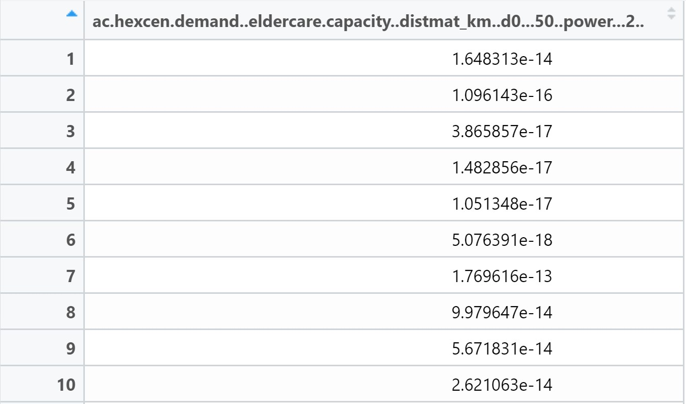
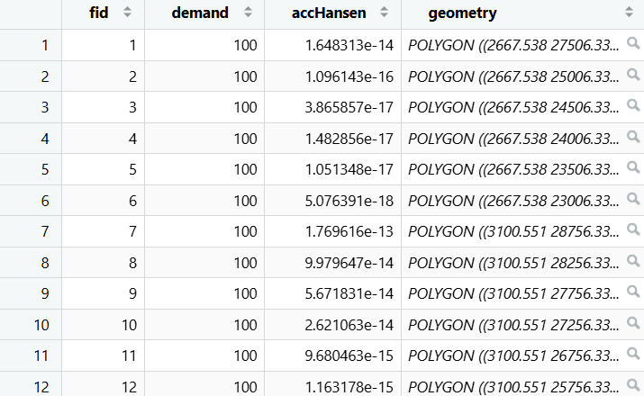

# 1. Overview

Spatial accessibility measures how easily individuals can reach key destinations—such as jobs, schools, clinics, and shops. Instead of measuring simple physical proximity, it accounts for real-world factors like travel time, transportation infrastructure, cost, and mobility limitations.

Accessibility modeling answers key questions, including:

- Which areas are underserved or cut off from vital public services and jobs?

- Who is most impacted by policy changes, such as school mergers across different educational levels?

In this hands-on workshop, we will apply R’s geospatial analysis packages to model real-world geographic accessibility.

## The data

Four data sets will be used in this hands-on exercise, they are:

- `MP14_SUBZONE_NO_SEA_PL`: URA Master Plan 2014 subzone boundary GIS data. This data set is downloaded from data.gov.sg.

- `hexagons`: A 250m radius hexagons GIS data. This data set was created by using [*st_make_grid()*](https://r-spatial.github.io/sf/reference/st_make_grid.html) of sf package. It is in ESRI shapefile format.

- `ELDERCARE`: GIS data showing location of eldercare service. [This data](https://data.gov.sg/dataset/eldercare-services) is downloaded from data.gov.sg. There are two versions. One in ESRI shapefile format. The other one in Google kml file format. For the purpose of this hands-on exercise, ESRI shapefile format is provided.

- `OD_Matrix`: a distance matrix in csv format. There are six fields in the data file. They are:

  - `origin_id`: the unique id values of the origin (i.e. `fid` of hexagon data set.),

  - `destination_id`: the unique id values of the destination (i.e. `fid` of `ELDERCARE` data set.),

  - `entry_cost`: the perpendicular distance between the origins and the nearest road),

  - `network_cost`: the actual network distance from the origin and destination,

  - `exit_cost`: the perpendicular distance between the destination and the nearest road), and

  - `total_cost`: the summation of `entry_cost`, `network_cost` and `exit_cost`.

All the values of the cost related fields are in **metres**.

In rhis exercise, we will use these R packages:

- Spatial data handling: **sf**

- Modelling geographical accessibility: **spatialAcc**

- Attribute data handling: **tidyverse, especially readr and dplyr**

- thematic mapping: **tmap**

- Staistical graphic: **ggplot2**

- Statistical analysis: **ggstatsplot**

```{r}
pacman::p_load(tmap, SpatialAcc, sf, 
               ggstatsplot, reshape2,
               tidyverse)
```

# 2. Geospatial Data Wrangling

## 2.1 Importing geospatial data

Three geospatial data will be imported from the *data/geospatial* sub-folder. They are MP14_SUBZONE_NO_SEA_PL, hexagons and ELDERCARE.

```{r}
mpsz <- st_read(dsn = "data/geospatial", layer = "MP14_SUBZONE_NO_SEA_PL")
```

```{r}
hexagons <- st_read(dsn = "data/geospatial", layer = "hexagons") 
```

```{r}
eldercare <- st_read(dsn = "data/geospatial", layer = "ELDERCARE") 
```

## 2.2 Updating CRS information

```{r}
mpsz <- st_transform(mpsz, 3414)
eldercare <- st_transform(eldercare, 3414)
hexagons <- st_transform(hexagons, 3414)
```

Verify transformed data

```{r}
st_crs(mpsz)
```

## 2.3 Cleaning and updating attribute fields of the geospatial data

Both the *`eldercare`* and *`hexagons`* data layers contain several redundant attributes that need to be dropped. The code chunk below removes these unnecessary fields and uses ***dplyr**'s* *mutate*() function to derive two essential metrics: a *`demand`* field in the `hexagons` layer and a *capacity field* in the *`eldercare`* simple features (sf) layer.

```{r}
eldercare <- eldercare %>%
  select(fid, ADDRESSPOS) %>%
  mutate(capacity = 100)
```

```{r}
hexagons <- hexagons %>%
  select(fid) %>%
  mutate(demand = 100)
```

# 3. Apsaital Data handling and Wrangling

## 3.1 Import Distance Matrix

```{r}
ODMatrix <- read_csv("data/aspatial/OD_Matrix.csv", skip = 0)
```

## 3.2 Tidying distance matrix


The imported matrix data above need to be transformed from a thin format into a thick format.

```{r}
distmat <- ODMatrix %>%
  select(origin_id, destination_id, total_cost) %>%
  spread(destination_id, total_cost)%>%
  select(c(-c('origin_id')))
```

**Note:** Starting with **`tidyr`** 1.0, `pivot_wider()` supersedes the retired `spread()` function.

Because the spatial layers use the **SVY21** projected coordinate system, distance is initially calculated in meters. The following code chunk converts these values from meters to kilometers while reshaping the matrix with `pivot_wider()`.

```{r}
distmat_km <- as.matrix(distmat/1000)
```

# 4. Modeling and Visualising Accessibility using Hansen Method

## 4.1 Computing Hansen's accessibility

We are now ready to compute Hansen’s potential accessibility using `ac()` from the **`SpatialAcc`** package. Before proceeding, review the function documentation (`?ac`) to ensure all necessary arguments—such as demand, supply capacity, and the travel matrix—are properly prepared.

The code chunk below calculates Hansen's accessibility metric with `ac()`, then converts and stores the result as a data frame named `acc_Hansen`.

```{r}
acc_Hansen <- data.frame(ac(hexagons$demand,
                            eldercare$capacity,
                            distmat_km, 
                            #d0 = 50,
                            power = 2, 
                            family = "Hansen"))
```



Next we rename the messy default field name.

```{r}
colnames(acc_Hansen) <- "accHansen"
```

Next, we will convert the data table into tibble format.

```{r}
acc_Hansen <- as_tibble(acc_Hansen)
```

Finally, we use `bind_cols()` from **`dplyr`** to combine the `acc_Hansen` tibble with the original `hexagons` simple features (`sf`) data frame. The resulting layer is saved as `hexagon_Hansen`.

```{r}
hexagon_Hansen <- bind_cols(hexagons, acc_Hansen)
```



::: callout-tip
the steps above can be perform by using a single code chunk as shown below

```{r}

acc_Hansen <- data.frame(ac(hexagons$demand,
                            eldercare$capacity,
                            distmat_km, 
                            #d0 = 50, 
                            power = 0.5, 
                            family = "Hansen"))

colnames(acc_Hansen) <- "accHansen" 

acc_Hansen <- as_tibble(acc_Hansen) 

hexagon_Hansen <- bind_cols(hexagons, acc_Hansen)

```
:::

## 4.2 Visualising Hansen's accessibility

### 4.2.1 Extracting map extend

Extract the extend of `hexagons` simple feature data frame

```{r}
mapex <- st_bbox(hexagons)

```

In the code chunk below, we use **`tmap`** functions to generate a high-quality thematic map depicting spatial accessibility to eldercare centres in Singapore.

```{r}
#| fig-width: 14
#| fig-height: 12
#| 
tm_shape(hexagon_Hansen,
         bbox = mapex) + 
  tm_polygons(fill = "accHansen", 
              fill.scale = tm_scale_intervals(
                style = "quantile",
                n = 10,
                values = "brewer.blues")) +
  tm_shape(eldercare) +
  tm_dots(size = 0.3,
          fill = "red",
          col = "black") +
  tm_title("Accessibility to eldercare: Hansen method", 2.5) +
  tm_layout(frame = TRUE,
            legend.position = tm_pos_out("center", "bottom"),
            legend.outside.size = 0.2
            ) +
  tm_compass(type="8star", size = 2) +
  tm_scalebar() +
  tm_grid(alpha = 0.2)
```

## 4.3 Statistical graphic visualisation

Next, we compare Hansen’s accessibility scores across different URA Planning Regions. The code chunk below attaches the planning region field to the `hexagon_Hansen` spatial data frame via a point-in-polygon or intersection join.

```{r}
hexagon_Hansen <- st_join(hexagon_Hansen, mpsz, 
                          join = st_intersects)
```

Next, *ggplot()* will be used to plot the distribution by using boxplot graphical method.

```{r}
#| fig-width: 10
#| fig-height: 6
ggplot(data=hexagon_Hansen, 
       aes(y = log(accHansen), 
           x= REGION_N)) +
  geom_boxplot() +
  geom_point(stat="summary", 
             fun.y="mean", 
             colour ="red", 
             size=2)
```

# 5. Modelling and Visualising Accessibility using KD2SFCA

## 5.1 Computing KD2SFCA's accessibility

In this section, we adapt our previous workflow into a consolidated code chunk to run the KD2SFCA accessibility model.

The code chunk below calculates accessibility by setting `family = "KD2SFCA"` inside `SpatialAcc::ac()`. The output is then wrapped in a data frame called `acc_KD2SFCA`.

```{r}
acc_KD2SFCA <- data.frame(ac(hexagons$demand,
                             eldercare$capacity,
                             distmat_km, 
                             d0 = 5,
                             power = 2, 
                             family = "KD2SFCA"))

colnames(acc_KD2SFCA) <- "accKD2SFCA"
acc_KD2SFCA <- as_tibble(acc_KD2SFCA)
hexagon_KD2SFCA <- bind_cols(hexagons, acc_KD2SFCA)
```

## 5.2 Visualising KD2SFCA's accessibility

Use a collection of mapping fucntions of tmap package to create a high cartographic quality accessibility to eldercare centre in Singapore.

```{r}
#| fig-width: 14
#| fig-height: 12

tm_shape(hexagon_KD2SFCA,
         bbox = mapex) + 
  tm_polygons(fill = "accKD2SFCA", 
              fill.scale = tm_scale_intervals(
                style = "quantile",
                n = 10,
                values = "brewer.blues")) +
  tm_shape(eldercare) +
  tm_dots(size = 0.3,
          fill = "red",
          col = "black") +
  tm_title("Accessibility to eldercare: KD2SFCA method", 2.5) +
  tm_layout(frame = TRUE,
            legend.position = tm_pos_out("center", "bottom"),
            legend.outside.size = 0.2) +
  tm_compass(type="8star", size = 2) +
  tm_scalebar() +
  tm_grid(alpha = 0.2)
```

## 5.3 Statistical graphic visualisation

We now compare the distribution of KD2SFCA accessibility values across URA Planning Regions. The following code chunk uses a spatial join to attach planning region fields directly to the `hexagon_KD2SFCA` spatial data frame.

```{r}
hexagon_KD2SFCA <- st_join(hexagon_KD2SFCA, mpsz, 
                           join = st_intersects)
```

Next, ggplot() will be used to plot the distribution by using boxplot graphical method.

```{r}
#| fig-width: 10
#| fig-height: 6

ggplot(data=hexagon_KD2SFCA, 
       aes(y = accKD2SFCA, 
           x= REGION_N)) +
  geom_boxplot() +
  geom_point(stat="summary", 
             fun.y="mean", 
             colour ="red", 
             size=2)


```

# 6. Modelling and Visualising Accessibility using Spatial Accessibility Measure (SAM) method

## 6.1 Computing SAM accessibility

In this section, we streamline the previous analysis steps into a single code block to compute the Spatial Accessibility Measure (SAM).

The following code chunk uses `SpatialAcc::ac()` with `family = "SAM"` and saves the calculated accessibility scores into a data frame called `acc_SAM`.

```{r}
acc_SAM <- data.frame(ac(hexagons$demand,
                         eldercare$capacity,
                         distmat_km, 
                         d0 = 5,
                         power = 2, 
                         family = "SAM"))

colnames(acc_SAM) <- "accSAM"
acc_SAM <- as_tibble(acc_SAM)
hexagon_SAM <- bind_cols(hexagons, acc_SAM)
```

## 6.2 Visualising SAM's accessibility

The following code chunk uses **`tmap`** functions to generate a high-quality map showing accessibility to eldercare centres in Singapore. Notice that `mapex` is passed into the `bbox` argument to define the bounding box of the display.

```{r}
#| fig-width: 14
#| fig-height: 10

tm_shape(hexagon_SAM,
         bbox = mapex) + 
  tm_polygons(fill = "accSAM", 
              fill.scale = tm_scale_intervals(
                style = "quantile",
                n = 10,
                values = "brewer.blues")) +
  tm_shape(eldercare) +
  tm_dots(size = 0.3,
          fill = "red",
          col = "black") +
  tm_title("Accessibility to eldercare: SAM method", 2.5) +
  tm_layout(frame = TRUE,
            legend.position = tm_pos_out("center", "bottom"),
            legend.outside.size = 0.2
            ) +
  tm_compass(type="8star", size = 2) +
  tm_scalebar() +
  tm_grid(alpha = 0.2)
```

## 6.3 Statistical graphic visualisation

We now compare the distribution of SAM accessibility scores across URA Planning Regions. The following code chunk uses `st_join()` to attach the planning region field to the `hexagon_SAM` spatial layer.

```{r}
hexagon_SAM <- st_join(hexagon_SAM, mpsz, 
                       join = st_intersects)
```

Next, ggplot() will be used to plot the distribution by using boxplot graphical method.

```{r}
#| fig-width: 10
#| fig-height: 6
ggplot(data=hexagon_SAM, 
       aes(y = accSAM, 
           x= REGION_N)) +
  geom_boxplot() +
  geom_point(stat="summary", 
             fun.y="mean", 
             colour ="red", 
             size=2)
```
