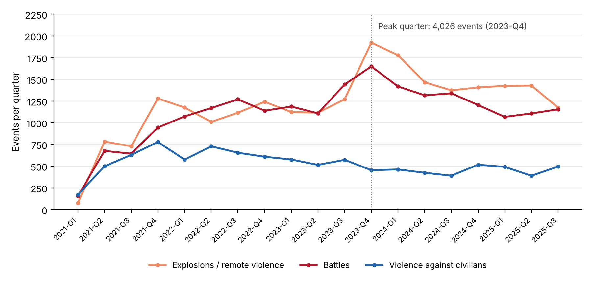
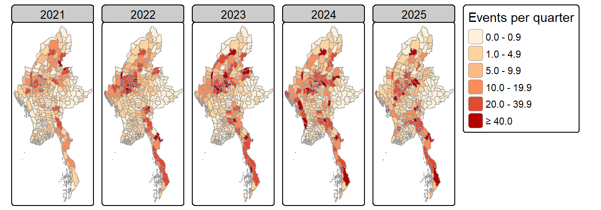
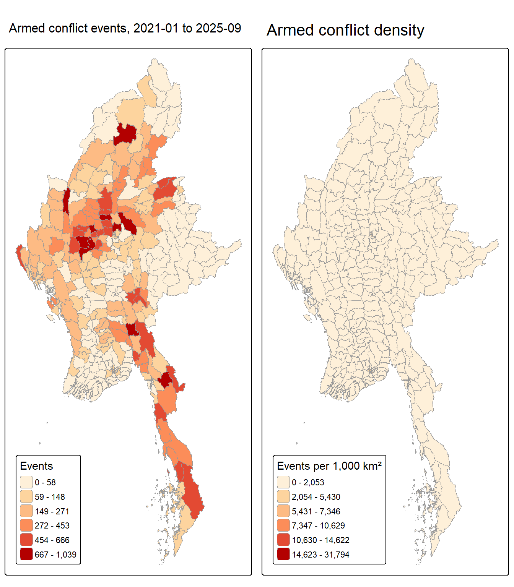
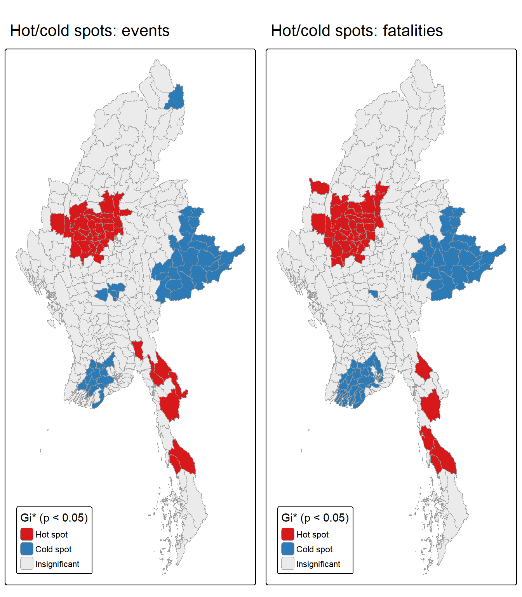
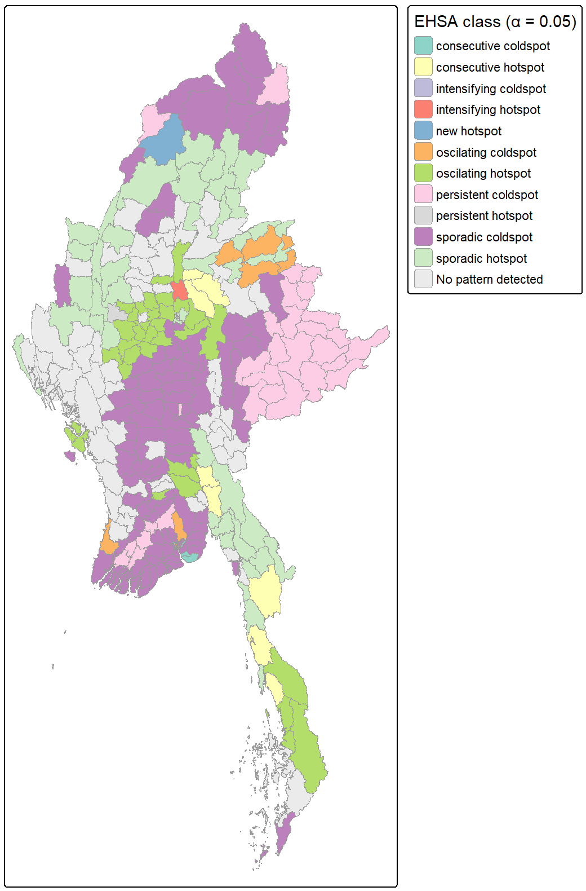

## Contents

::::: columns
::: {.column width="50%"}
1.  Research question
2.  Study area and data
3.  Analytical approach
4.  Key findings at a glance
5.  Conflict over time
:::

::: {.column width="50%"}
6.  Where conflict concentrates
7.  Hot spots and clusters (LMSA)
8.  How hot spots evolve (EHSA)
9.  Limitations
10. Public-safety implications
:::
:::::

::: takeaway
**Bottom line:** Myanmar's post-coup violence is not spread evenly. It is anchored in a **Central Dry Zone core** (Sagaing–Magway–Mandalay) that keeps re-igniting, with **two southern corridors** and a **new southward frontier** in Bago (West) emerging.
:::

## 1 · Research question

:::::::: columns
::: {.column width="58%"}
Since the February 2021 coup, Myanmar has slid from protest into nationwide civil war: thousands killed, over three million displaced, and large areas outside junta control.

**Main question:** *Where does armed conflict cluster across Myanmar's 330 townships, and how have those clusters moved and changed between 2021-Q1 and 2025-Q3?*

- **Q1 · Spatial (LMSA):** which townships are statistically significant hot spots, cold spots or outliers over the whole period?
- **Q2 · Spatio-temporal (EHSA):** where is violence new, intensifying, persistent, oscillating or cooling?
:::

:::::: {.column width="42%"}
::: finding
**Why township level?** It is the administrative unit at which humanitarian access, aid delivery and local ceasefire arrangements are negotiated.
:::

::: {.finding .blue}
**Why statistics, not just maps?** A busy-looking township may simply be large. Local statistics test whether a cluster is stronger than chance would produce.
:::

::: {.finding .amber}
**Audience:** peace-building, humanitarian and civilian-protection actors who need to prioritise scarce resources.
:::
::::::
::::::::

## 2 · Study area and data

:::::::: kpi-row
::: kpi
[330]{.num} [townships (MIMU v9.4, admin level 3)]{.lab}
:::

::: kpi
[19]{.num} [quarters, 2021-Q1 to 2025-Q3]{.lab}
:::

::: kpi
[53,907]{.num} [armed-conflict events analysed (of 87,109 ACLED records)]{.lab}
:::

::: kpi
[89,012]{.num} [reported fatalities (a lower bound)]{.lab}
:::

::: {.kpi .blue}
[6,270]{.num} [township × quarter cells in the space-time cube]{.lab}
:::
::::::::

::::: columns
::: {.column width="52%"}
| Dataset | Use |
|----|----|
| **ACLED Myanmar**, Jan 2021 – Sep 2025 (CSV) | Geocoded conflict events with type, date, location precision, fatalities |
| **MIMU township boundaries v9.4** (shapefile) | 330 polygons, re-projected to UTM 47N (EPSG:32647) |
:::

::: {.column .small width="48%"}
**"Armed conflict" defined as** ACLED's three use-of-force types: Battles (21,069) · Explosions/remote violence (22,899) · Violence against civilians (9,939).

**Removed:** protests, riots, strategic developments; 4 events at sea; 93 events located only to a regional centroid (geo-precision 3).

Events joined to townships by **point-in-polygon**, not by name (two township names repeat). Eight near-shore points snapped to the nearest township (\< 1 km).
:::
:::::

## 3 · Analytical approach

:::::::: pipeline
::: step
[1 · Wrangle]{.stephead}

Filter, spatial join, zero-filled township × quarter panel; space-time cube
:::

[→]{.arrow}

::: step
[2 · Explore]{.stephead}

National trend, choropleths of counts, density and yearly change
:::

[→]{.arrow}

::: step
[3 · Neighbours]{.stephead}

Queen contiguity + nearest neighbour for 3 island townships; row-standardised
:::

[→]{.arrow}

::: step
[4 · LMSA]{.stephead}

Global Moran's I · Local Moran's I · Getis-Ord Gi\* (999 permutations)
:::

[→]{.arrow}

::: step
[5 · EHSA]{.stephead}

Quarterly Gi\* → Mann-Kendall trend → emerging hot-spot classes
:::
::::::::

::::: {.columns .small}
::: {.column width="50%"}
**Key analytical decisions**

- **Quarterly bins:** monthly leaves too many zero cells; yearly gives only 5 points for a trend test.
- **Event counts** are the primary variable; **fatalities** a secondary check (heavily skewed, conservatively coded).
- **Permutation p-values** throughout: counts are skewed and zero-heavy, so normal-theory p-values are unreliable.
:::

::: {.column width="50%"}
**Significance rules (α = 0.05)**

- LISA and Gi\* maps show only townships with permutation p \< 0.05.
- EHSA uses `threshold = 0.05` (the function default is 0.01).
- Persistent hot/cold spots are kept on the EHSA map: they have significant Gi\* every quarter but, by definition, *no* trend.
- Robustness: Benjamini-Hochberg false-discovery-rate check.
:::
:::::

## 4 · Key findings at a glance

::::::::::: columns
:::::: {.column width="50%"}
::: finding
**1 · Conflict escalated and stayed high.** From 401 events in 2021-Q1 to a peak of **4,026 in 2023-Q4**; still about 2,800–3,200 a quarter in 2025.
:::

::: finding
**2 · Remote violence now leads.** Air strikes, shelling and drones overtook battles from 2023-Q4 and have stayed at or above battles since.
:::

::: finding
**3 · The Central Dry Zone is the epicentre.** Sagaing, Magway and Mandalay hold **43% of events**; Sagaing alone has **23% of events and 31% of deaths**.
:::
::::::

:::::: {.column width="50%"}
::: finding
**4 · Clustering is strong and real.** Global Moran's I = **0.49** (events) and **0.56** (fatalities), p \< 0.001. **38 hot spots**, 18 of them in Sagaing.
:::

::: {.finding .amber}
**5 · Hot spots recur rather than resolve.** 34 *oscillating* hot spots, mainly in the Dry Zone and Tanintharyi; 8 *consecutive* hot spots along two corridors; **new** (Hkamti) and **intensifying** (Singu) hot spots.
:::

::: {.finding .blue}
**6 · Calm areas are cooling further.** Yangon, the Ayeyarwady delta and Shan (East) are cold spots; urban Yangon and Mandalay show the strongest *downward* trends.
:::
::::::
:::::::::::

## 5 · Conflict over time: escalation, then a high plateau

::::: columns
::: {.column width="55%"}
{width="100%"}

[Armed-conflict events per quarter by type (n = 53,907).]{.tiny}
:::

::: {.column .small width="45%"}
- Events rose **7.5-fold** within the first year (401 → 3,004) as resistance turned to armed struggle.
- The **2023-Q4 spike** (+23% on the previous quarter) coincides with the late-2023 resistance offensives in northern Shan and elsewhere.
- **Explosions/remote violence** became the largest category: violence increasingly comes from the air and from a distance, exposing civilians far from front lines.
- **Violence against civilians** peaked in 2021-Q4 (779) and has eased, but remains about 400–500 events a quarter.

{width="100%"}

[Average events per quarter by year (2025 = Jan–Sep): the Dry Zone intensifies, then activity spreads down the south-east and into Rakhine in 2024.]{.tiny}
:::
:::::

## 6 · Where conflict concentrates

:::::: columns
::: {.column width="44%"}
{height="760px"}
:::

:::: {.column .small width="56%"}
**Left: event counts. Right: events per 1,000 km².** The two maps are read together because township size varies by over four orders of magnitude.

- **Busiest townships:** Monywa (1,039 events), Kawkareik (946), Myaing (934), Kale (886), Hpakant (854), Shwebo (806).
- **Raw counts** highlight the large Dry Zone, Kayin and Tanintharyi townships.
- **Density** brings out compact urban townships (Yangon, Mandalay) where many incidents occur in small areas. Some of this reflects early urban guerrilla attacks.
- **Quiet areas:** Shan (East) (41 events in total) and the Ayeyarwady delta.

::: takeaway
**Visual evidence:** conflict is concentrated, not random. That is what the LMSA tests on the next slide confirm.
:::
::::
::::::

## 7 · Hot spots and clusters (LMSA, p \< 0.05)

::::: columns
::: {.column width="44%"}
{height="760px"}
:::

::: {.column .small width="56%"}
**Getis-Ord Gi\*.** Red = a township *and its neighbours* have significantly more conflict than average.

|                              |  Events  | Fatalities |
|------------------------------|:--------:|:----------:|
| Hot spots                    |  **38**  |   **40**   |
| Cold spots                   |    50    |     63     |
| LISA High-High clusters      |    33    |     37     |
| Significant after FDR (Gi\*) | 43 of 88 | 68 of 103  |

- **One dominant hot zone:** Sagaing (18), Mandalay (7) and Magway (5). The strongest are Salingyi, Yesagyo, Myaing, Singu and Chaung-U.
- **Southern hot strip:** Kayin and Tanintharyi, along the Thai border.
- **Cold spots:** Yangon, the Ayeyarwady delta and Shan (East/North/South). Shan (East) is cold in every test.
- **No High-Low outliers:** violent townships are always surrounded by violent neighbours. Violence spills over township borders.
- The **fatality** map almost duplicates the event map: *the most active areas are also the most lethal.*
:::
:::::

## 8 · How hot spots evolve (EHSA, α = 0.05)

::::::::: columns
::: {.column width="40%"}
{height="780px"}
:::

::::::: {.column .small width="60%"}
::: finding
**Recurring core:** 34 **oscillating** hot spots: 9 in Sagaing, 9 in Mandalay, 5 in Magway, 4 in Tanintharyi. They are hot in the latest quarter but were significant *cold* spots in some earlier quarters: violence arrived and keeps recurring rather than easing. **Pale** (Sagaing) is the only **persistent** hot spot.
:::

::: {.finding .amber}
**Emerging:** **Hkamti** (northern Sagaing) is a **new** hot spot; **Singu** (Mandalay) is **intensifying**. The strongest rising trends (Mann-Kendall τ ≈ 0.65–0.75) are in **Bago (West)** (Okpho, Minhla, Gyobingauk, Letpadan), **Chauk**, **Pyinoolwin**, **Natogyi** and **Nyaung-U**. The front is pushing south and east of the Dry Zone.
:::

::: finding
**Two corridors:** 8 **consecutive** hot spots, hot in every recent quarter without a break. One runs along northern Shan–Mandalay (Kyaukme, Nawnghkio, Mogoke). The other runs along Bago (East)–Kayin–Tanintharyi (Shwegyin, Kyaukkyi, Yebyu, Thayetchaung, Kyainseikgyi).
:::

::: {.finding .blue}
**Cooling:** 80 townships have significant downward trends against 57 upward. The strongest are urban Mandalay and Yangon, and Muse–Kutkai in northern Shan. 31 **persistent** cold spots, mainly Shan (East) and the delta.
:::
:::::::
:::::::::

## 9 · Limitations

::::: {.columns .small}
::: {.column width="50%"}
**Data**

- **Reporting bias:** ACLED depends on media and local sources. Internet shutdowns and restricted access probably under-count remote areas. Fatalities are a conservative lower bound.
- **Location precision:** 45% of retained events are placed at a locality centroid (geo-precision 2), which can stack events in one township.
- **Counts, not rates:** no population denominator was used; area density is only a partial adjustment.
- **Event types are pooled:** an air strike and a skirmish each count as one event.
:::

::: {.column width="50%"}
**Method**

- **Scale (MAUP):** results depend on township boundaries and quarterly bins. Other units could shift cluster edges.
- **Multiple testing:** 330 local tests. Only about half the significant townships survive FDR correction, so individual townships should be read with care. Regional patterns are robust.
- **Neighbour choice:** queen contiguity plus nearest-neighbour links for 3 islands. EHSA uses a one-quarter lag and 199 simulations.
- **EHSA classes are descriptive:** Mann-Kendall detects only monotonic trends. "Low" or "cold" means *below the national mean*, not peaceful.
- **Association, not causation:** no covariates (terrain, territorial control, roads) are modelled.
:::
:::::

## 10 · Public-safety and peace-building implications

::::::::::: {.columns .small}
:::::: {.column width="50%"}
::: finding
**Treat the Dry Zone as a long-term emergency.** The oscillating and persistent hot spots (Pale, Salingyi, Monywa, Myaing, Yesagyo) are hot now and have recurred over several years. A quieter quarter there is not a recovery. Sustain protection, medical and food programming.
:::

::: {.finding .amber}
**Build an early-warning watchlist.** Track new and intensifying hot spots (Hkamti, Singu) and the fastest-rising townships in Bago (West), Chauk, Pyinoolwin and Nyaung-U. Pre-position aid and identify shelters *before* the front arrives.
:::

::: finding
**Secure the corridors.** Consecutive hot spots line the northern Shan–Mandalay and Bago (East)–Kayin–Tanintharyi routes. Plan convoy timing, safe routes and displacement monitoring along them.
:::
::::::

:::::: {.column width="50%"}
::: finding
**Prioritise protection from remote violence.** With air and drone strikes now the leading event type, invest in strike early-warning, bunkers and shelters, and documentation of attacks on schools and clinics.
:::

::: {.finding .blue}
**Support the cold spots as receiving areas.** Yangon, the delta and Shan (East) are calm relative to the rest of the country and likely absorb displaced people. Host-community services and livelihoods there reduce the risk of new tension.
:::

::: {.finding .blue}
**Use cooling areas as entry points for peace-building.** Townships with significant downward trends (e.g. Muse–Kutkai, urban Mandalay) are where local ceasefires, recovery and dialogue are most likely to hold.
:::
::::::
:::::::::::

::: takeaway
**One message:** focus on where violence *recurs and spreads*, not only where it is highest today.
:::
